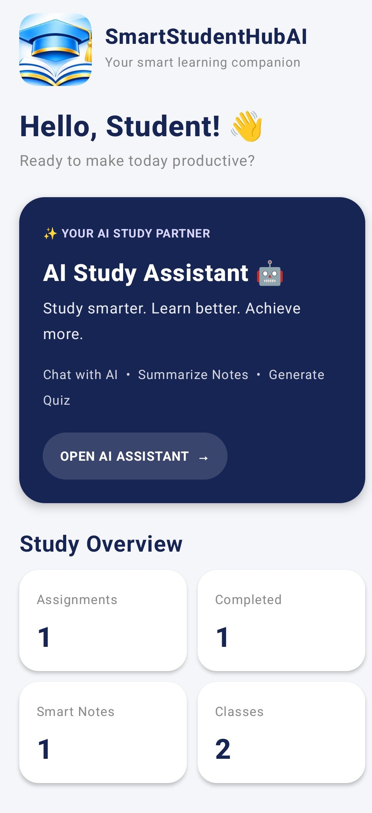
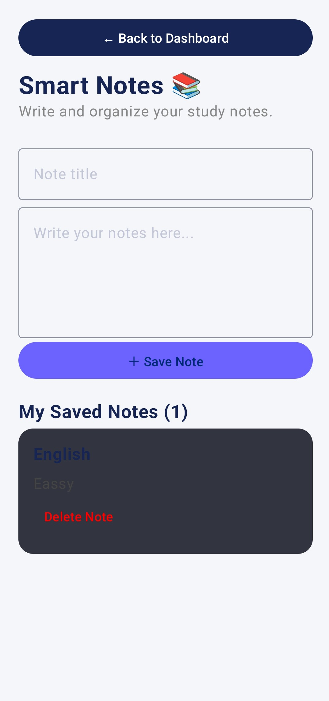
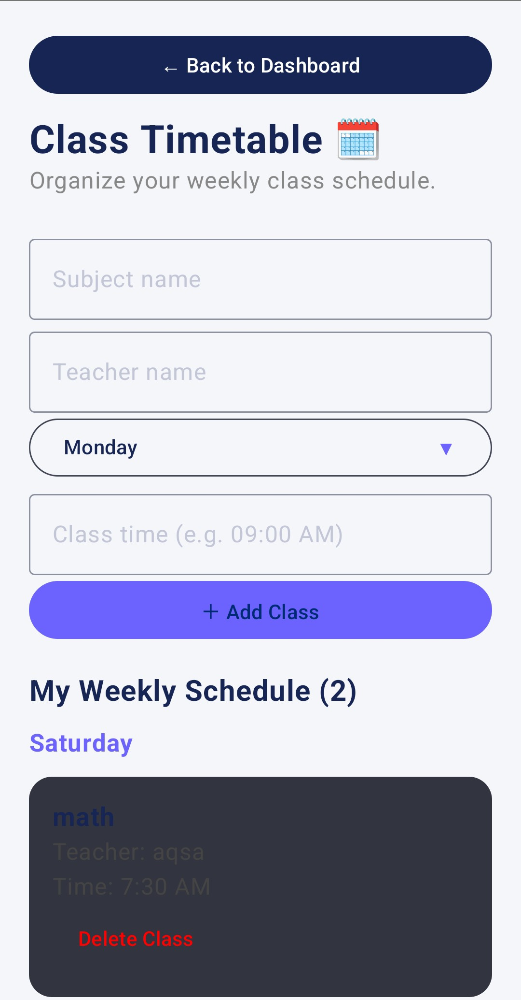
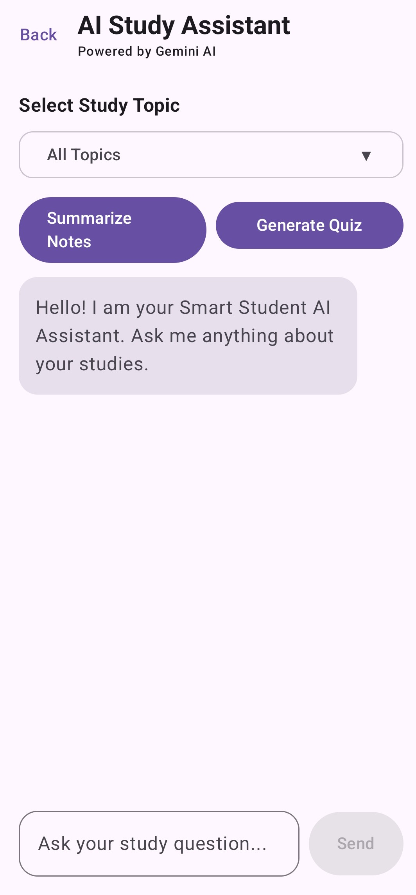

SmartStudentHubAI

A Smart Student Productivity Android Application

SmartStudentHubAI is an Android application designed to help students organize their academic activities in one place.

Features

- Student Dashboard
- Assignment Management
- Smart Notes
- Class Timetable
- Class Reminder Notifications
- Reminder Notifications on the device

Technology Stack

- Kotlin
- Jetpack Compose
- Material 3
- Android Studio
- SharedPreferences

Project Information

- Project Name: SmartStudentHubAI
- Developer: Muhammad Imran
- Platform: Android
- Language: Kotlin

Developer

Muhammad Imran

GitHub: https://github.com/imrankhan2241006

---

© 2026 Muhammad Imran. All Rights Reserved.

## App Screenshots

### Home Dashboard

### Home Dashboard 1

### Assignments

### Smart Notes

### Timetable

### AI Assistant

